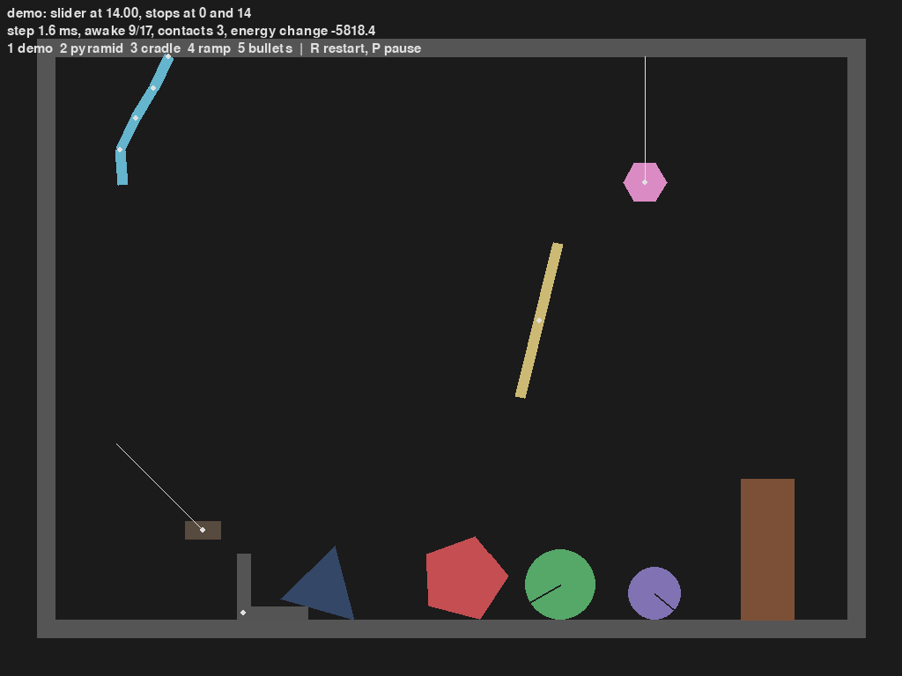
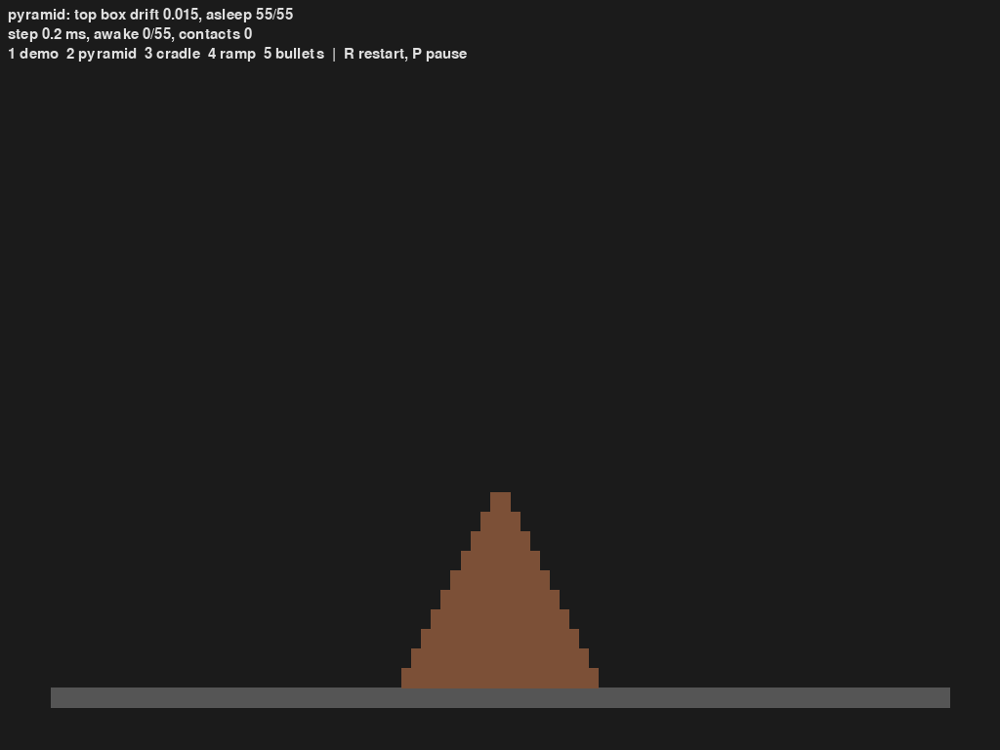
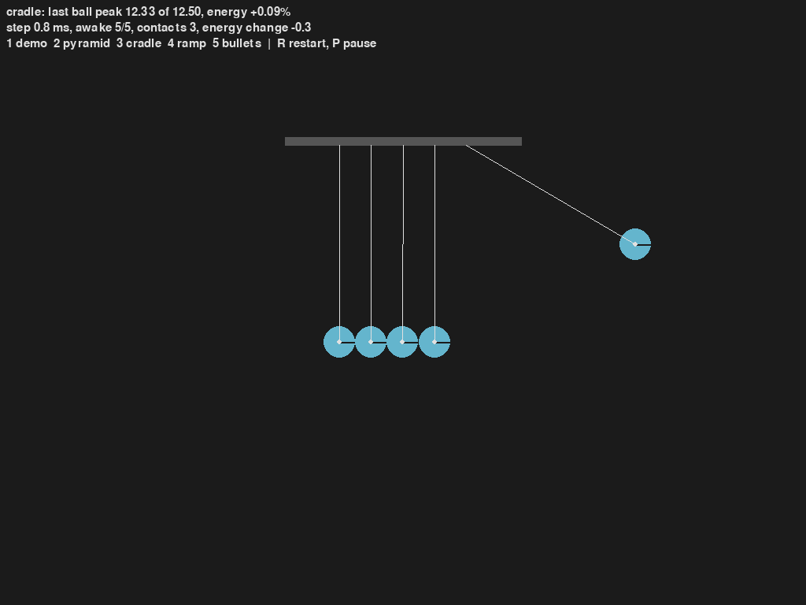
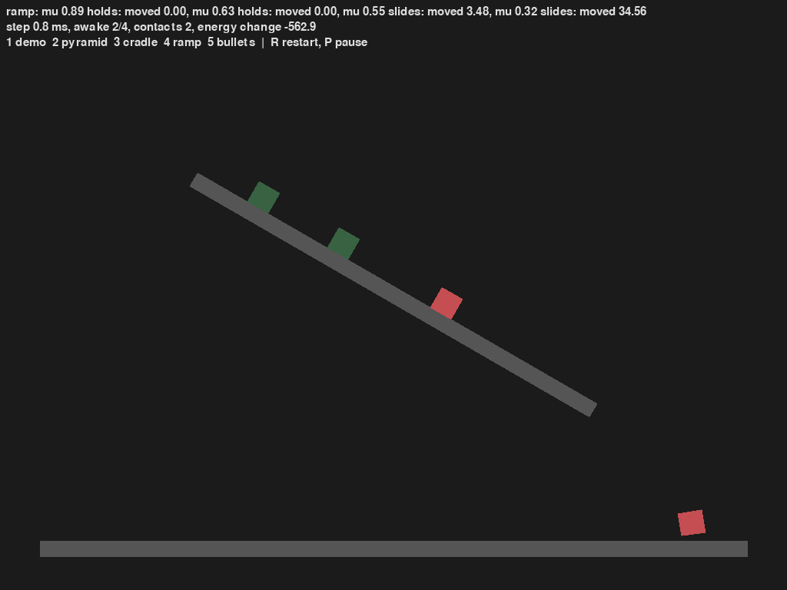
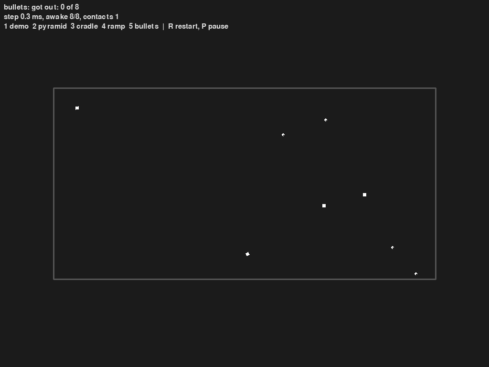

# pure-py-engine

A 2D rigid-body physics engine in plain Python. The `engine` package has no dependencies; the pygame-ce demo and check scenes live in `main.py`.

- Shapes: circles and convex polygons, separating-axis collision with Box2D-style edge clipping (up to two contact points, each with its own depth).
- Solver: sequential impulses with accumulated clamping, warm started from the previous step; Coulomb friction, restitution above an impact-speed threshold, Baumgarte position correction.
- Continuous collision: speculative contacts. Each awake body's reach this step (speed, spin, gravity) widens its broadphase box and the SAT margin, so a fast body is stopped at the first surface instead of tunnelling.
- Joints: `RevoluteJoint` and `PrismaticJoint` (optional `lower` / `upper` stops and motor), `WeldJoint`, `DistanceJoint` (rigid, or a spring with `hertz` / `damping_ratio`), `MouseJoint`.
- Performance: sweep-and-prune broadphase, world vertices and AABBs cached until a body moves, sleeping islands.

Status: experiment. Speculative contacts can stop a body a fraction of a step early; distance joints have no min / max length.

## Requirements

Python 3.14+ and pygame-ce (demo only).

## Usage

```python
from engine import Body, RevoluteJoint, World

world = World(gravity=(0, -10))
ground = world.add(Body.box(40, 2, pos=(0, -1), static=True))
crate = world.add(Body.box(2, 2, pos=(0, 5), angle=0.3))
ball = world.add(Body.circle(0.5, pos=(4, 3), restitution=0.8))
world.add(RevoluteJoint(ground, ball, (4, 5)))  # pendulum pinned 2 above the ball

for _ in range(300):
    world.step(1 / 60)
print(f"{crate.pos.y:.2f} {crate.awake}")  # 1.00 False: landed and fell asleep
```

Bodies are built with `Body.circle`, `Body.polygon`, `Body.box` or `Body.regular`, with keyword options `mass`, `pos`, `angle` (radians), `v`, `w`, `friction`, `restitution`, `static`. Points and vectors may be `Vec2` or `(x, y)`. Polygon vertices can be in either winding and anywhere around the origin; they are stored counter-clockwise around their centroid, and non-convex or zero-area input raises `ValueError`.

Joint anchors are world points at the moment the joint is made; `RevoluteJoint.angle` and `PrismaticJoint.translation` count from that pose, and the stops use the same zero. Jointed bodies do not collide unless `collide_connected=True`.

`World` tuning: `iterations` (default 10), `time_to_sleep` (0.5 s, `math.inf` disables sleeping), `sleep_linear`, `sleep_angular`. `apply_impulse`, `MouseJoint.target` and new joints wake a body.

## Demo

```bash
uv run main.py
```

Keys 1 to 5 switch scenes, R restarts the current one, P pauses. The top line of each scene is a readout of what it should show; the second line has the step time, awake bodies and contact pairs. Sleeping bodies are drawn dimmed.

In every scene, drag a body with the left mouse button (a `MouseJoint`), B fires a 400 units/s bullet, Space kicks everything upward, arrow keys pan, mouse wheel zooms.

| Key | Scene | What a working engine shows |
|---|---|---|
| 1 | demo | Loose shapes, a stack, a hanging chain, a motorised windmill, a welded L, a spring, a slider on a diagonal rail; the slider stays between its stops at 0 and 14 |
| 2 | pyramid | 55 boxes in 10 rows stay up and fall asleep; the top box drifts by a few hundredths |
| 3 | cradle | Newton's cradle with elastic, frictionless balls on rods: the last ball rises almost as high as the first fell, and energy stays within a fraction of a percent |
| 4 | ramp | Boxes on a 30 degree slope: those with a friction coefficient of at least tan 30 = 0.577 (green) hold, the others (red) slide |
| 5 | bullets | Eight bullets at 100 to 800 units/s in a box of 0.2 thick walls: none get out, even after hitting each other |

`uv run main.py --save docs` runs each scene for 3 seconds without a window and saves the last frame. The frames below came from that command; their readouts were:

```text
demo: slider at 14.00, stops at 0 and 14
pyramid: top box drift 0.015, asleep 55/55
cradle: last ball peak 12.33 of 12.50, energy change -0.09%
ramp: mu 0.89 holds: moved 0.00, mu 0.63 holds: moved 0.00, mu 0.55 slides: moved 3.48, mu 0.32 slides: moved 34.56
bullets: got out: 0 of 8
```

| | |
|---|---|
|  |  |
|  |  |
|  | |

## Test

```bash
uv run --with pytest pytest
```

## Structure

```
engine/gmath.py      Vec2, AABB, polygon area / centroid / convexity, regular_polygon, rectangle
engine/collide.py    point tests, SAT for polygons and circles, contact point clipping
engine/body.py       Body: shape, mass, cached world vertices / AABB, impulses, sleep state
engine/contact.py    narrowphase dispatch, Arbiter (persistent contact, friction, warm start)
engine/joints.py     revolute, weld, distance, prismatic, mouse joints; limits and motors
engine/world.py      World: broadphase, islands and sleeping, solver loop
main.py              pygame demo: Camera, check scenes and their readouts, drawing, input, --save
docs/                one frame of each scene, from main.py --save docs
test_engine.py       geometry, SAT, response, conservation, stacking, sleeping, tunnelling, each joint, the demo scene
```
